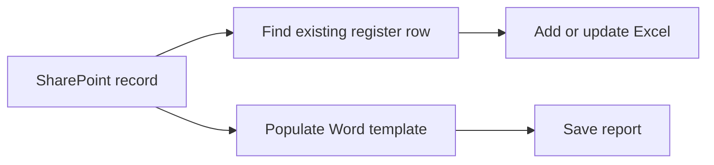

# Experiment Record Automation

Two Power Automate flow definitions for synchronising structured experiment records with an Excel register and generating a Word report from a selected record.

This is a sanitised portfolio template. Site addresses, organisation/user identifiers, connection references, file IDs and table IDs use placeholders. Original timestamps and cached document metadata have been removed. No experiment results, researcher records, reports or source documents are included.

## Flows

| Definition | Purpose |
| --- | --- |
| `flows/sync-to-excel.definition.json` | Find a spreadsheet record by SharePoint ID, then add or update it |
| `flows/generate-report.definition.json` | Populate a Word template from a selected record and write a report |

**Stack:** Power Automate, SharePoint, Excel Online, Word Online.

## Rebuild in a Test Environment

These are flow definitions, not a complete Power Platform solution package. They demonstrate the actions and mappings; they do not include the source SharePoint list, Excel workbook or Word template.

1. Create a test SharePoint list, workbook/table and Word template.
2. Recreate the flow actions using the definitions as a reference, or incorporate them into your own supported solution/export process.
3. Replace `contoso`, `ExampleSite`, `YOUR_...` values and zero-style GUIDs with your own test resources.
4. Map the list fields and Word content controls to the example fields. These include experiment ID, date, researcher, protocol, equipment, materials, results, review status and record links.
5. Use synthetic records to verify updates and generated documents before connecting operational data.

## Scope

The project demonstrates record automation. It is not a certified quality system and makes no claim of regulatory compliance. Keep source records, completed reports, connection exports and environment-specific metadata out of Git.
